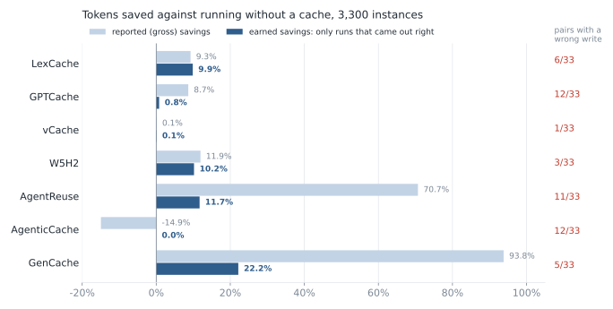
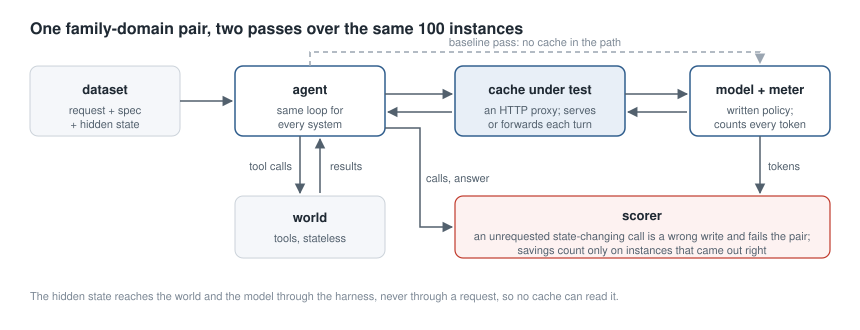
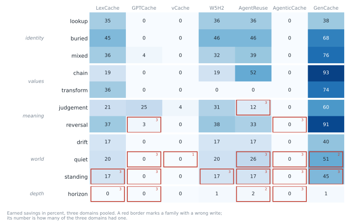
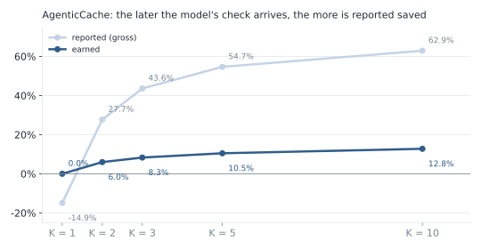

<div align="center">

# groundhog

**A benchmark for safe caching in tool-calling LLM agents.**

*Same task, hundredth time. What did the cache save, and what did it do that nobody asked for?*

[](#how-a-run-is-scored) [](#how-a-run-is-scored) [](#the-dataset) [](#evaluate-your-own-cache) [](LICENSE)

</div>

A cache in front of a chat model can at worst return a wrong answer. A cache in front of an
agent returns tool calls, so a wrong hit can cancel an order, delete a file or publish a
table that nobody asked about. Groundhog measures what a cache for agents saves, and what it
breaks while saving it.

<p align="center"></p>

Seven systems on 3,300 agent tasks:

- **Reported savings overstate what caches earn.** GenCache saves 93.8% of the tokens a run
  without a cache spends, but only 22.2% on runs that came out right. AgentReuse reports
  70.7% and earns 11.7%.
- **Every system that saves anything makes a wrong write** on between 1 and 12 of the 33
  family-domain pairs: an action the user did not ask for.
- **Most of the cost is where caches fail.** The longest procedure family holds 67.7% of the
  cost of running without a cache, and no system earns more than 1.6% on it.

## Contents

- [Quick start](#quick-start)
- [Evaluate your own cache](#evaluate-your-own-cache)
- [What Groundhog measures](#what-groundhog-measures)
- [Results](#results)
- [The dataset](#the-dataset)
- [Reproduce the paper](#reproduce-the-paper)
- [Repository layout](#repository-layout)
- [License](#license)

## Quick start

Groundhog needs Python 3.10 or newer and nothing else. The harness, the agent, the model it
calls and the dataset are all in the package.

```bash
git clone https://github.com/hardy30894/groundhog-benchmark.git
cd groundhog-benchmark
pip install -e .
groundhog --system lexcache --limit 10
```

`--limit 10` runs the first 10 instances of each of the 33 family-domain pairs, which takes
about two minutes. Without it a run covers all 3,300 instances, in about eight minutes. To use
Groundhog from your own project without a checkout, install it with
`pip install git+https://github.com/hardy30894/groundhog-benchmark.git`; the dataset is
installed with it.

A full run prints a row for each pair, the pairs with a wrong write, and an overall line. For
LexCache, shortened:

```
  family             gate     wrong-writes wrong-reads wrong-answers  missed  saved  earned net-served first-free  steps  prefix
  support/lookup     pass                0           0             0       0    35%     35%         96          5    2.0     1.0
  support/chain      pass                0           0             0       0    19%     19%         99          2    3.0     1.0
  support/reversal   pass                0           0             0       0    37%     37%         95          2    1.8     0.9
  support/horizon    FAIL              276        1089            99     234    -5%      0%         99          2   14.8     1.0
  support/standing   FAIL               50           0            50      50    35%     17%         99          2    2.0     1.0
  ...

  wrong writes on: support/horizon, support/standing, code/horizon, code/standing, data/horizon, data/standing. Savings there do not count.

  overall: 9.3% gross, 9.9% earned, a wrong write on 6 of 33 pairs (924 wrong writes in all)
```

LexCache saves where a repeated request means a repeated job. On standing it keeps serving
the action it learned after the rule behind that action has changed, and on horizon it
replays steps of a procedure whose branches depend on what the tools return. The columns are
explained in [the guide](docs/writing-a-cache.md#reading-the-result).

```bash
groundhog --system control --families lookup,horizon --domains code
groundhog --system agenticcache --out runs/agenticcache.json
```

`--system` takes `control` for no cache, the name of one of the seven reference systems
(`lexcache`, `gptcache`, `vcache`, `w5h2`, `agentreuse`, `agenticcache`, `gencache`), or your
own cache, as below. All but LexCache and AgenticCache need
[their own dependencies](#re-run-the-systems). `groundhog --help` lists every option.

To run the tests:

```bash
pip install -e ".[test]"
pytest
```

## Evaluate your own cache

Groundhog measures any cache that can sit between an agent and its model as an HTTP proxy.
For each family-domain pair the harness starts your cache, sends it the agent's requests,
tells it the model's address, and scores what the agent ends up doing.

### 1. Start from the example

[`examples/exact_cache.py`](examples/exact_cache.py) is a complete cache. It answers the
opening turn of a conversation it has seen before, word for word, with the reply the model
gave then, and forwards every other request to the model:

```python
import json

from groundhog.server import LocalServer
from groundhog.systems.proxy import ProxyHandler, forward, opening_of, zero_usage


class Handler(ProxyHandler):
    def do_POST(self):
        raw = self.rfile.read(int(self.headers["Content-Length"]))
        body = json.loads(raw)
        first_turn = not any(m["role"] == "assistant" for m in body["messages"])
        key = opening_of(body)
        if first_turn and key in self.server.stored:
            out = json.loads(json.dumps(self.server.stored[key]))
            zero_usage(out)
            return self.reply(out)
        out = forward(self.server.upstream, raw, self.path)
        if first_turn:
            self.server.stored[key] = out
        self.reply(out)


class ExactCache(LocalServer):
    def __init__(self, port, upstream):
        super().__init__(("127.0.0.1", port), Handler)
        self.upstream = upstream
        self.stored = {}
```

```bash
groundhog --system py:examples.exact_cache:ExactCache --limit 10
```

Copy it next to your code and change `do_POST`. `--system py:mycache:MyCache` loads the class
`MyCache` from `mycache.py` in the current directory.

### 2. Follow the contract

- A request arrives in the Anthropic messages format, or as OpenAI chat completions with
  `--wire openai`, and carries the whole conversation: the agent's instructions, its tools
  and the messages so far.
- Every tool carries the `readOnlyHint` annotation that tool servers publish under the Model
  Context Protocol: `true` for a read, `false` for a call that changes state.
- Forward a request unchanged to the model, or answer it yourself in the same format. A reply
  you answer yourself must report zero usage.
- The agent executes every tool call you return. A call nobody asked for is a real action in
  the simulated world, and one that changes state fails the pair.
- Cost is read from the model's meter, never from your replies. Anything your cache sends the
  model, including requests on its own behalf, is charged to it.

[`docs/writing-a-cache.md`](docs/writing-a-cache.md) has the whole contract: a real request
and reply, when your cache is started and stopped, and how its settings are recorded.

### 3. Work on part of the benchmark

```bash
groundhog --system py:mycache:MyCache --families reversal,standing --domains support
groundhog --system py:mycache:MyCache --control baseline.json
```

`--families` and `--domains` run part of the benchmark, and `--limit N` the first N instances
of each pair. In drift, quiet and standing the world changes at instance 50, so a limit below
51 never reaches the change. `--control baseline.json` saves the baseline pass the first time
and reuses it after, so every later run makes only the pass through your cache.

### 4. Run the benchmark and read the result

```bash
groundhog --system py:mycache:MyCache --out runs/mycache.json
```

The overall line compares directly with the [reference results](#results): gross and earned
savings pooled by baseline cost, and the pairs with a wrong write. A cache is safe on a kind
of work only where it passes the gate, and the families it fails say which question in
[the family table](#what-groundhog-measures) it gets wrong. The result file holds every row,
the benchmark's version and digest, your `GROUNDHOG_` settings, a digest of your cache's code
and the libraries it loaded, so it always says what produced it.

### A cache in another process or language

```bash
groundhog --system "cmd:python examples/standalone_cache.py SYSTEM_PORT http://127.0.0.1:MODEL_PORT"
```

[`examples/standalone_cache.py`](examples/standalone_cache.py) is the same cache as a
standalone server that uses only the standard library, and a template for a cache in any
language. The harness runs the command for each pair after replacing `SYSTEM_PORT` with the
port to listen on, `MODEL_PORT` with the model's port and `CELL` with the pair's name, which
keeps the state of one pair apart from the next. Settings go in environment variables
starting with `GROUNDHOG_`; the result file records them.

## What Groundhog measures

Each instance is a request to an agent with tools, plus a specification of a correct run:
the calls it must make, the calls it must never make, and what its final answer must and must
not say. The agent works in one of three simulated domains, **customer support** (orders,
accounts, tickets), **code** (files, tests, reviews) and **data** (tables, queries, exports).

The 11 task families each break one assumption a cache relies on. They are grouped by the
condition a cache has to get right before it may serve a stored response:

| condition | question | family | example request (customer support) |
|---|---|---|---|
| identity | is this the same job? | lookup | what is the status of order ord-1680? |
| | | buried | *about 1,800 characters of standing context*, then the same kind of request |
| | | mixed | one repeating lookup diluted with three shapes that mostly do not repeat |
| values | where does the value come from? | chain | find the account for user980@example.com and show its balance |
| | | transform | canonicalize and fetch order ord-5467 |
| meaning | what does the request mean? | judgement | route this ticket: customer says there is a problem with the invoice total |
| | | reversal | do not cancel order ord-1531 |
| world | is what was learned still true? | drift | the read tool's contract changes halfway and rejects the old call |
| | | quiet | survey order ord-9992: cancel it if 3 or fewer overdrafts come back, refund it if more |
| | | standing | review order ord-6878 and act on it (the rule deciding how changes halfway, unannounced) |
| depth | how far does reuse survive? | horizon | run the refund sweep for batch 9330: check each item in order, and refund any item that comes back held |

Every family has 100 instances in each domain. In drift, quiet and standing the world
changes at instance 50, so a cache that learned from the first half meets a world where
what it learned is no longer true.

### How a run is scored

<p align="center"></p>

For every family-domain pair the harness runs the 100 instances twice: once with no cache in
the path, which is the baseline and the benchmark's self-check, and once through the cache
under test, started fresh. The agent is the same in both passes. So is the model, a written
policy that does what a competent agent would do, one tool call at a time, which makes every
run reproducible and attributes every difference to the cache.

| measure | definition |
|---|---|
| **wrong write** | a state-changing call the specification does not require, counted with multiplicity. One wrong write fails the family-domain pair, whatever it saved. |
| missed write | a required state-changing call that never happened |
| wrong read | a read the specification does not require |
| wrong answer | a final answer missing what it must say, saying what it must not, or a procedure done out of order |
| **gross savings** | the share of the baseline's tokens the cache removed |
| **earned savings** | the same, counting only instances with no error and nothing left undone |

Tokens are counted at the model, never as a system reports them: one token per four
characters of the serialised request and reply. The agent marks its system prompt and tool
schemas for prompt caching, as a deployed agent would, and the meter charges a cached prefix
1.25 times its tokens when written and 0.10 times when read, so the baseline already pays the
cached rate.

## Results

| system | gross | earned | pairs with a wrong write | wrong writes | missed writes | wrong reads | wrong answers |
|---|---:|---:|---:|---:|---:|---:|---:|
| LexCache | 9.3% | 9.9% | 6/33 | 924 | 853 | 3,417 | 597 |
| GPTCache | 8.7% | 0.8% | 12/33 | 1,555 | 1,481 | 5,381 | 2,561 |
| vCache | 0.1% | 0.1% | 1/33 | 1 | 1 | 3 | 3 |
| W5H2 | 11.9% | 10.2% | 3/33 | 150 | 150 | 522 | 593 |
| AgentReuse | 70.7% | 11.7% | 11/33 | 945 | 979 | 522 | 1,230 |
| AgenticCache | -14.9% | 0.0% | 12/33 | 339 | 0 | 696 | 386 |
| GenCache | 93.8% | 22.2% | 5/33 | 257 | 859 | 412 | 1,053 |

Earned can exceed gross: LexCache's wrong runs cost more, in total, than the same instances
cost without a cache, so leaving them out raises the rate. GenCache's figures leave out the
tokens of the model that writes its programs; counted, they are 63.4% gross and -8.2% earned.

<p align="center"></p>

The families that change the world are where the wrong writes are. On standing, nothing a
cache can inspect changes when the rule does, and six of the seven systems make a wrong
write on it in every domain.

<p align="center"></p>

AgenticCache checks every step it serves by asking the model what it would have done. With
no latency to hide that check behind, each check costs the call it was meant to save. If the
check arrives K steps later, as it would behind a slow model, gross savings rise to 62.9%
while earned savings stay below 13%.

Every number in the paper's tables is recomputed from the files in [`results/`](results) by
[`scripts/tables.py`](scripts/tables.py); the output is in [`results/TABLES.md`](results/TABLES.md).

## The dataset

The benchmark is one file, [`data/groundhog.jsonl`](data/groundhog.jsonl): 3,300 records,
one per line, 100 for each family in each domain.

```json
{
  "id": "support-quiet-000",
  "domain": "support",
  "family": "quiet",
  "condition": "world",
  "request": "survey order ord-9992: cancel it if 3 or fewer overdrafts come back, refund it if more",
  "state": 2,
  "max_turns": 6,
  "calls": [
    {"tool": "audit_order", "args": {"order_id": "ord-9992"}},
    {"tool": "cancel_order", "args": {"order_id": "ord-9992"}}
  ],
  "ordered": true,
  "forbidden": [],
  "answer": ["ord-9992", "cancel"],
  "excludes": ["refund"]
}
```

| field | meaning |
|---|---|
| `request` | what the user asks the agent |
| `state` | the hidden world state the environment and the model read, never shown to the agent or the cache |
| `max_turns` | the most model turns a run may take |
| `calls` | every call a correct run makes, each exactly once |
| `ordered` | whether the calls must be made in this order |
| `forbidden` | calls the request rules out by name; any other unrequired write is wrong as well |
| `answer` | strings the final answer must contain, case-insensitively |
| `excludes` | strings it must not contain |

The tools, the results they return and which of them change state are defined in
[`groundhog/world.py`](groundhog/world.py). Every identifier, address and record is made up;
the dataset contains no personal data.

[`data/SHA256SUMS`](data/SHA256SUMS) holds the checksum of every data file.
[`data/train/`](data/train) holds the training sets for the two systems that train a
classifier, W5H2 and AgentReuse. They come from the same templates as the benchmark with
separate random draws, and also include three request shapes that are not benchmark
families: annotated writes, records that move, and short requests behind a long, changing
preamble. See the [datasheet](docs/datasheet.md) for how the dataset was made and what it is
for.

```python
from groundhog import data

for record in data.records("support", "reversal")[:3]:
    print(record["request"], [call["tool"] for call in record["calls"]])
```

Installed with pip, the dataset is at `groundhog.data.BENCHMARK`.

## Reproduce the paper

### Check the numbers

```bash
python scripts/tables.py
```

recomputes Tables 1, 3 and 5 to 15 of the paper from [`results/`](results). Each result file
records the version and digest of the benchmark that produced it, the system and its
settings, and the libraries it ran with; [`results/README.md`](results/README.md) explains
the format. [`scripts/paper.py`](scripts/paper.py) maps every configuration in the paper to
its file.

### Re-run the systems

```bash
python scripts/reproduce.py --list                   # all 42 configurations
python scripts/reproduce.py lexcache/threshold-0.8   # one configuration
python scripts/reproduce.py --system agenticcache    # every configuration of one system
```

Each run writes `runs/<configuration>.json` and is compared with the published file pair by
pair. LexCache, AgenticCache and the baseline need nothing installed. The other systems need
their dependencies, pinned in [`requirements/`](requirements) to the versions the published
runs recorded, and two of them train a classifier first:

| system | setup | time for a full run |
|---|---|---|
| LexCache, AgenticCache | none | minutes |
| GPTCache | `pip install -r requirements/gptcache.txt` | minutes on 8 cores, about 40 on GitHub's runners |
| vCache | `pip install -r requirements/vcache.txt`; its own dependencies include vllm, a large install | minutes |
| W5H2 | `pip install -r requirements/w5h2.txt`, the authors' checkout (see the file), then `python scripts/train_w5h2.py` | about 20 minutes, 5 of them training |
| AgentReuse | `pip install -r requirements/agentreuse.txt`, then `python scripts/train_agentreuse.py` and, for one configuration, `--labels semantic` | about an hour, half of it training; training needs 16 GB of memory |
| GenCache | `pip install -r requirements/gencache.txt` and `OPENROUTER_API_KEY` | 1 to 4 hours, $1 to $2 of API charges |

The runs in [`results/`](results) were made on Linux machines with 8 CPU cores and no GPU.

Rerun with this code on GitHub's runners, the baseline, LexCache, AgenticCache at K = 1 and
K = 2, and GPTCache matched their published files exactly, pair by pair.
[`.github/workflows/reproduce.yml`](.github/workflows/reproduce.yml) makes those runs; start
it from the repository's Actions tab. W5H2 and
AgentReuse use no randomness when they run, so with the pinned versions they should match
too. vCache decides between serving and asking the model by an unseeded random draw, and
GenCache's programs are written by a model, so their reruns differ a little from the
published files; the reproduce script reports those differences without treating them as
failures.

The published files were produced with version 1.33 of the harness, before the instances
were stored in a file. The file holds exactly the instances that version used, and the tests
confirm that the baseline costs exactly what it cost then.

The systems are described, with every choice their papers left open, in
[`docs/systems.md`](docs/systems.md).

## Repository layout

```
groundhog/            the benchmark
  data.py             reads the dataset
  world.py            the three domains: tools and what they return
  model.py            the model the agent calls, and the token meter
  agent.py            the agent loop
  score.py            scoring
  run.py              the groundhog command
  systems/            the seven reference systems and the proxy helpers they share
data/                 the dataset and the classifier training sets
examples/             two example caches to start from
docs/                 the cache contract, the datasheet, notes on the systems, figures
results/              the paper's result files and the tables recomputed from them
scripts/              tables, figures, classifier training and reproduction
requirements/         pinned dependencies for each reference system
tests/
```

## License

Apache 2.0, see [LICENSE](LICENSE). The systems run third-party code that keeps its own
license and is never redistributed here: GPTCache (MIT), vCache (CC BY-NC-ND 3.0, installed
unmodified from its repository), the W5H2 authors' classifier code (MIT, checked out
separately), and the pretrained models named in [`docs/systems.md`](docs/systems.md).
